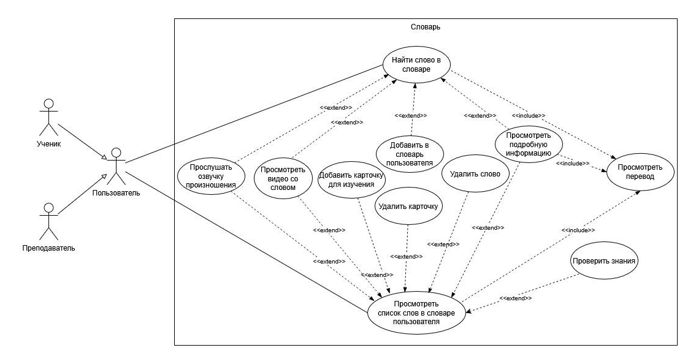
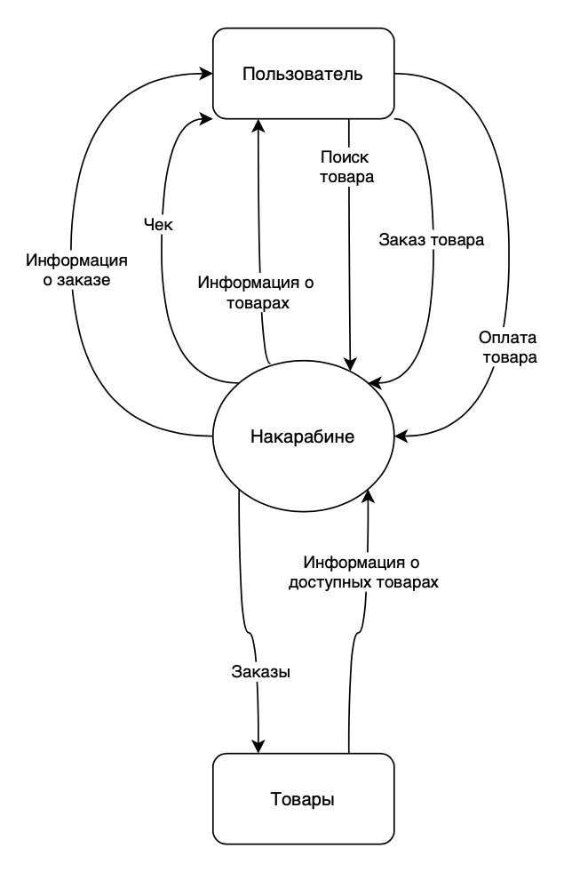
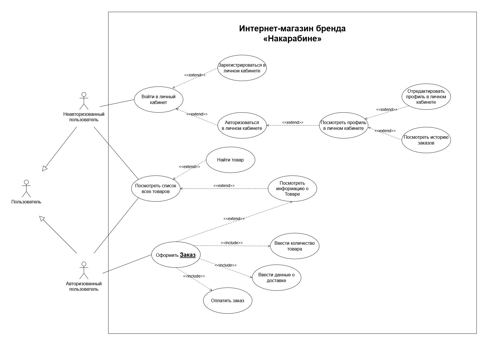

# 01 · Требования

Спецификации требований к ПО и варианты использования для двух веб-приложений.

[← К оглавлению](../README.md)

---

## Спецификация требований к ПО: Chatty 2.0

**Chatty** — веб-приложение для изучения английского языка. Версия 2.0 добавляет личный словарь и карточки для запоминания слов.

Спецификация построена по шаблону SRS К. Вигерса и содержит:
- классы пользователей (ученик, преподаватель) и их характеристики;
- операционную среду, ограничения, предположения и зависимости;
- 11 вариантов использования словаря и карточек;
- функциональные требования к словарю и карточкам;
- требования к данным: логическая модель и словарь данных;
- требования к внешним интерфейсам и атрибуты качества с измеримыми значениями — например, загрузка страницы не дольше 3 секунд, до 500 пользователей в пиковый час.

Файл: [srs-chatty-2.0.pdf](srs-chatty-2.0.pdf)

## Варианты использования: карточки Chatty

Подробные спецификации пяти вариантов использования раздела карточек: просмотр списка, добавление слов из словаря, переключение направления перевода, проверка перевода, статистика по карточке.

У каждого варианта — уровень, предусловие, минимальные гарантии и гарантии успеха, триггер, базовый сценарий и расширения: пустой список, недоступный словарь, повторное добавление слова.

Файл: [use-cases-chatty-flashcards.pdf](use-cases-chatty-flashcards.pdf)

---

## Спецификация требований к ПО: «Накарабине» 1.0

**«Накарабине»** — интернет-магазин одежды, амуниции и снаряжения для активного отдыха. Он заменяет продажу через маркетплейсы собственным веб-приложением.

Спецификация по тому же шаблону: контекстная диаграмма, классы пользователей, варианты использования заказа (каталог, поиск, корзина, доставка, оплата картой или при получении), функциональные требования, требования к данным и атрибуты качества.

Файл: [srs-nakarabine.pdf](srs-nakarabine.pdf)

## Use Case интернет-магазина «Накарабине»

UML-диаграмма вариантов использования для неавторизованного и авторизованного пользователя. Связи `<<include>>` показывают обязательные шаги оформления заказа (количество, доставка, оплата), `<<extend>>` — необязательные (поиск, просмотр карточки товара, история заказов).

Полный лист — диаграмма и спецификации девяти вариантов использования (ВИ-1…ВИ-9):
Файл: [use-cases-nakarabine-full.jpg](use-cases-nakarabine-full.jpg)

Исходник: [nakarabine-data-modeling.drawio](../04-data/nakarabine-data-modeling.drawio), вкладка «Use Case».
