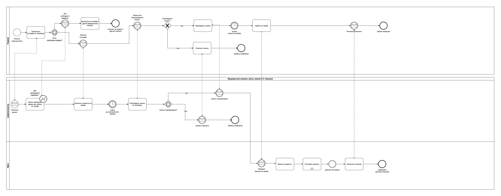
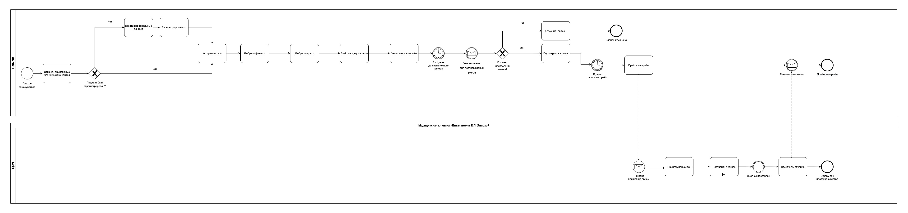
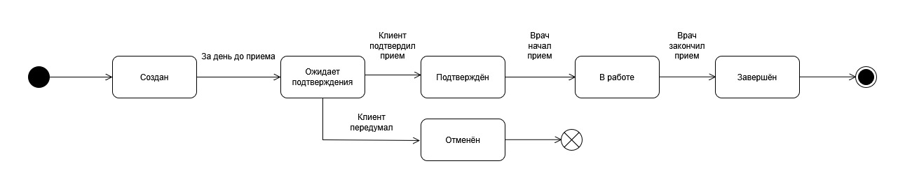

# 02 · Процессы

Моделирование процесса записи пациента к врачу в медицинской клинике «Вита»: как он устроен сейчас, как изменится с мобильным приложением и через какие статусы проходит запись.

[← К оглавлению](../README.md)

---

## BPMN AS-IS: запись к врачу по телефону

Текущий процесс. Участники — пациент, администратор и врач клиники. Пациент звонит, администратор ищет свободное время и записывает, за день до приёма перезванивает для подтверждения. Если времени нет, пациент уходит в другую клинику.

**Узкие места:** администратор вручную ищет слоты и обзванивает пациентов, запись зависит от его доступности по телефону, часть пациентов теряется на этапе «нет свободного времени».

## BPMN TO-BE: запись через мобильное приложение

Целевой процесс. Пациент сам выбирает филиал, врача, дату и время в приложении. Новых пациентов приложение просит зарегистрироваться, а за день до приёма само отправляет уведомление с просьбой подтвердить запись.

**Что изменилось:** администратор больше не участвует в записи и подтверждении, ручные звонки заменены уведомлением, процесс врача остался прежним.

## UML State Machine: жизненный цикл записи на приём

Статусы записи и события, которые её переводят: «Создан» → за день до приёма «Ожидает подтверждения» → «Подтверждён» → врач начал приём «В работе» → «Завершён». Если клиент передумал на этапе подтверждения — «Отменён».

Диаграмма задаёт статусную модель для разработки: какие статусы хранить, какие переходы допустимы и что их запускает.

---

Исходник всех трёх диаграмм: [clinic-process-modeling.drawio](clinic-process-modeling.drawio) — вкладки «BPMN AS-IS», «BPMN TO-BE», «UML State Machine Diagram».

Экраны приложения для этого процесса — в [вайрфреймах](../05-prototypes/README.md#вайрфреймы-приложения-записи-к-врачу).
