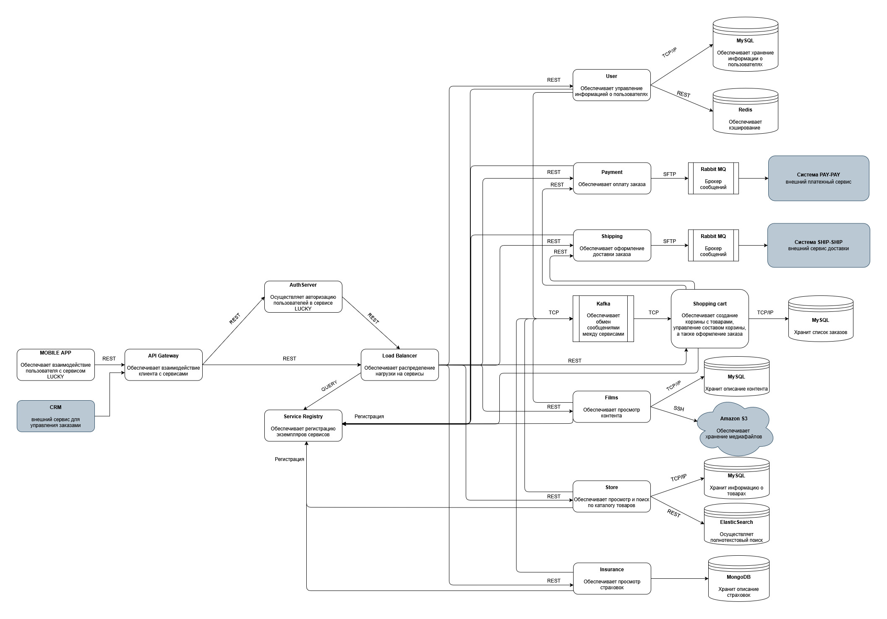
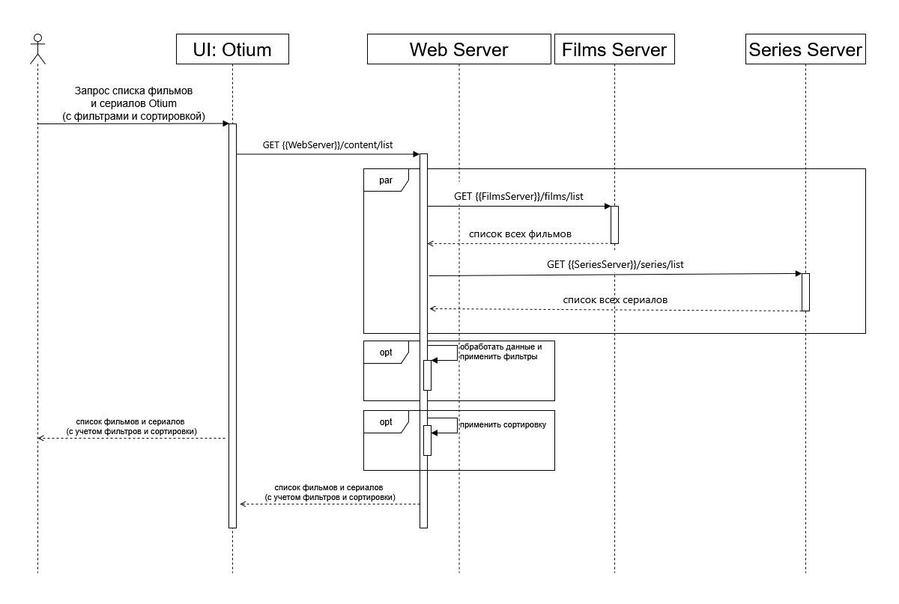
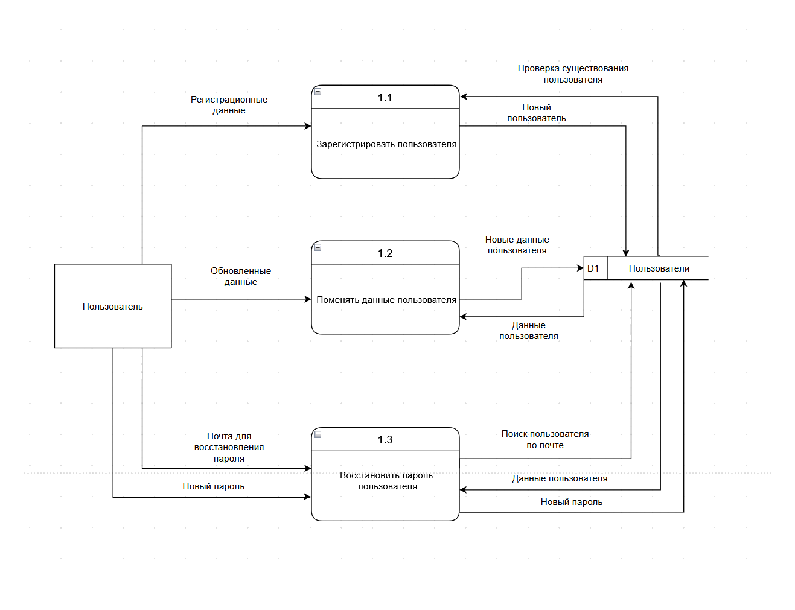
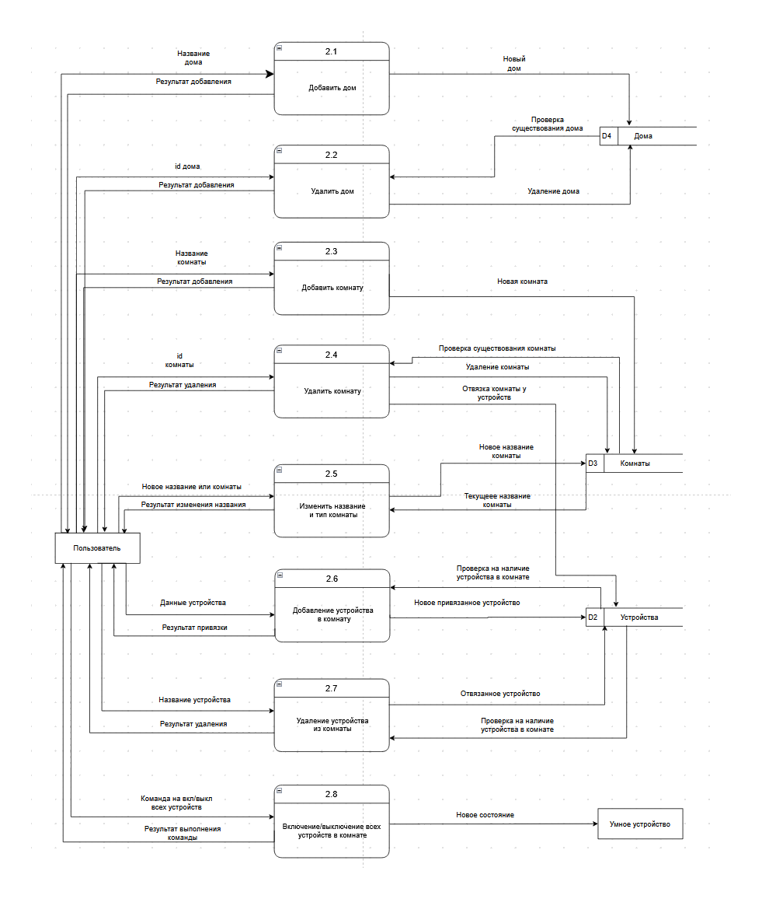
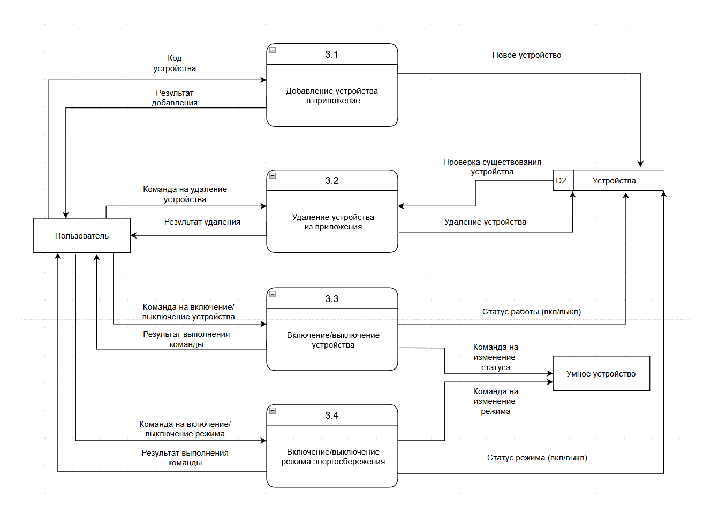
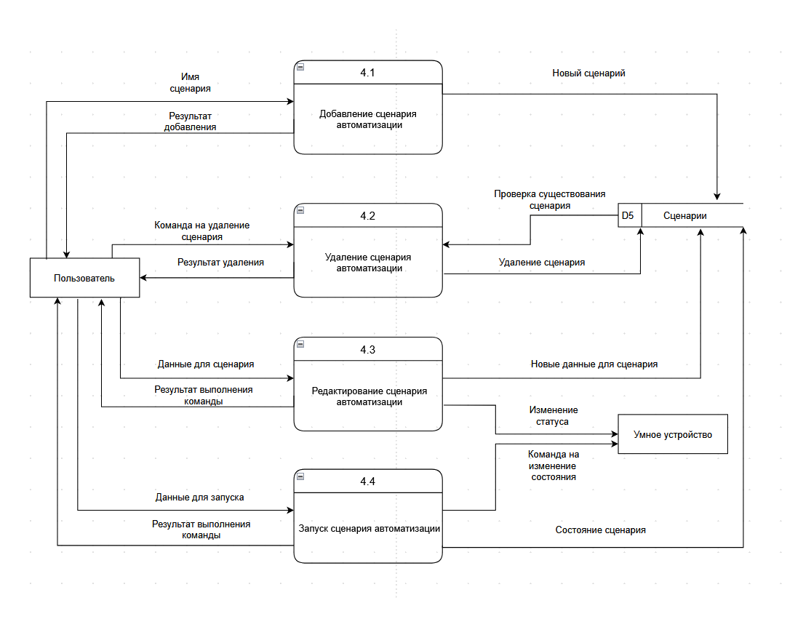

# 03 · Проектирование системы

Архитектура, взаимодействие сервисов и потоки данных для трёх систем.

[← К оглавлению](../README.md)

---

## C4: диаграмма контейнеров LUCKY

Архитектура мобильного сервиса LUCKY на уровне контейнеров C4. Запросы мобильного приложения и внешней CRM проходят через API Gateway, сервер авторизации и балансировщик нагрузки к микросервисам:

| Сервис | Назначение | Хранилище и интеграции |
|---|---|---|
| User | Данные пользователей | MySQL, кэш Redis |
| Store | Каталог и поиск товаров | MySQL, ElasticSearch |
| Shopping cart | Корзина и оформление заказа | MySQL, события через Kafka |
| Payment | Оплата заказа | RabbitMQ → внешняя платёжная система PAY-PAY |
| Shipping | Доставка заказа | RabbitMQ → внешняя служба доставки SHIP-SHIP |
| Films | Просмотр контента | MySQL, медиафайлы в Amazon S3 |
| Insurance | Просмотр страховок | MongoDB |

Экземпляры сервисов регистрируются в Service Registry. На связях подписаны протоколы: REST, TCP, SFTP.

---

## Sequence: список фильмов и сериалов Otium

Как онлайн-кинотеатр Otium отдаёт пользователю список фильмов и сериалов с фильтрами и сортировкой.

Диаграмма - часть [задачи на разработку](../06-documentation/README.md#задача-на-разработку-сортировка-по-рейтингу-otium) сортировки по рейтингу.

---

## DFD приложения Stets Home

Диаграммы потоков данных мобильного приложения «умный дом» Stets Home - декомпозиция по четырём функциональным областям.

Номера процессов совпадают с номерами функций на [диаграмме структуры интерфейса](../05-prototypes/README.md#структура-интерфейса-stets-home).

### 1 · Пользователи

Регистрация, изменение данных, восстановление пароля.

### 2 · Дома и комнаты

Добавление и удаление домов и комнат, привязка устройств к комнате, включение и выключение всех устройств в комнате.

### 3 · Устройства

Добавление устройства по коду, удаление, включение и выключение, режим энергосбережения.

### 4 · Сценарии автоматизации

Создание, редактирование, удаление и запуск сценариев.

Исходник всех четырёх диаграмм: [stets-home-dfd.drawio](stets-home-dfd.drawio).
