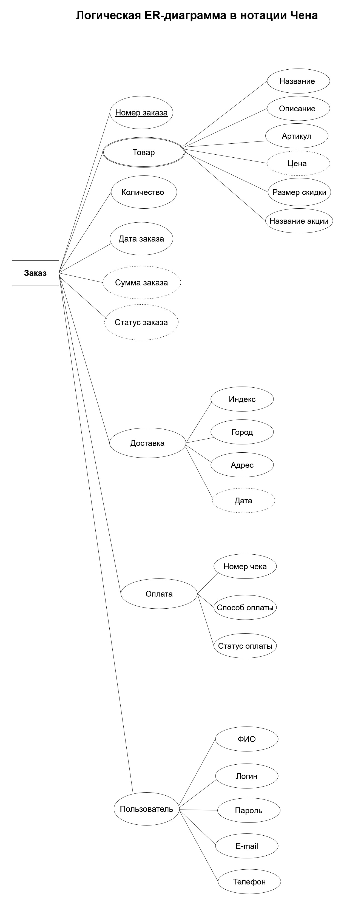
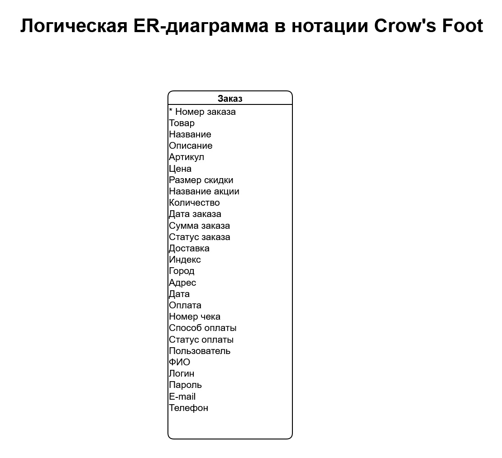
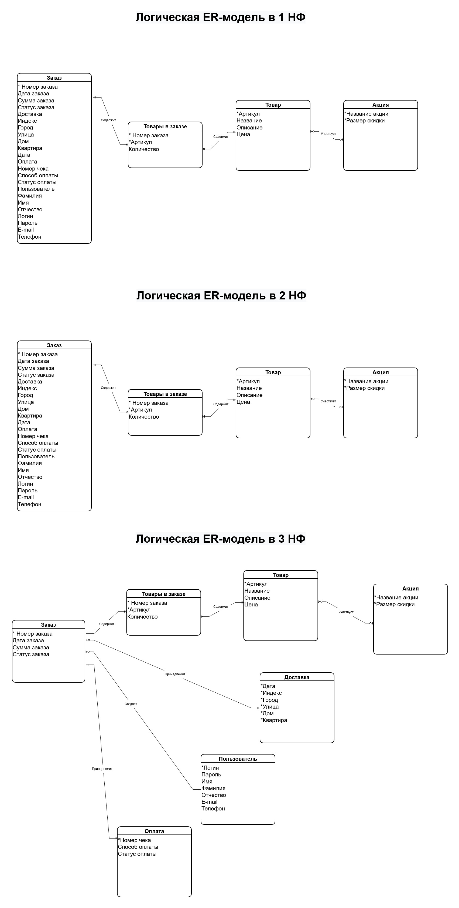
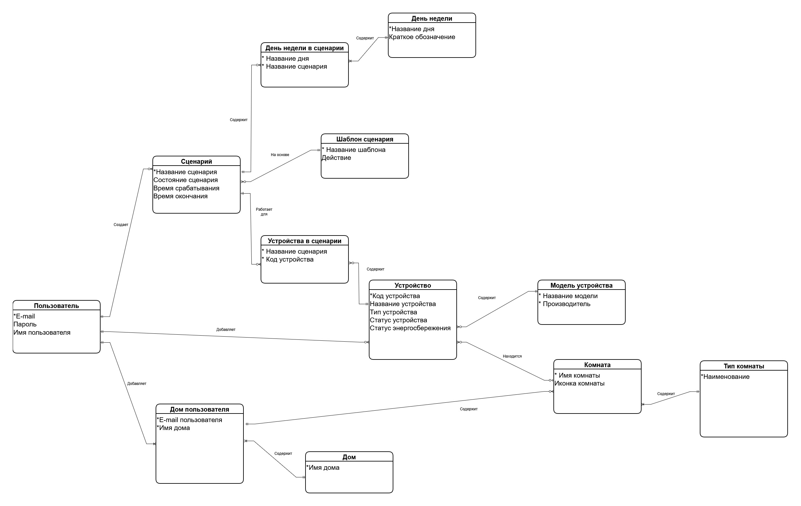
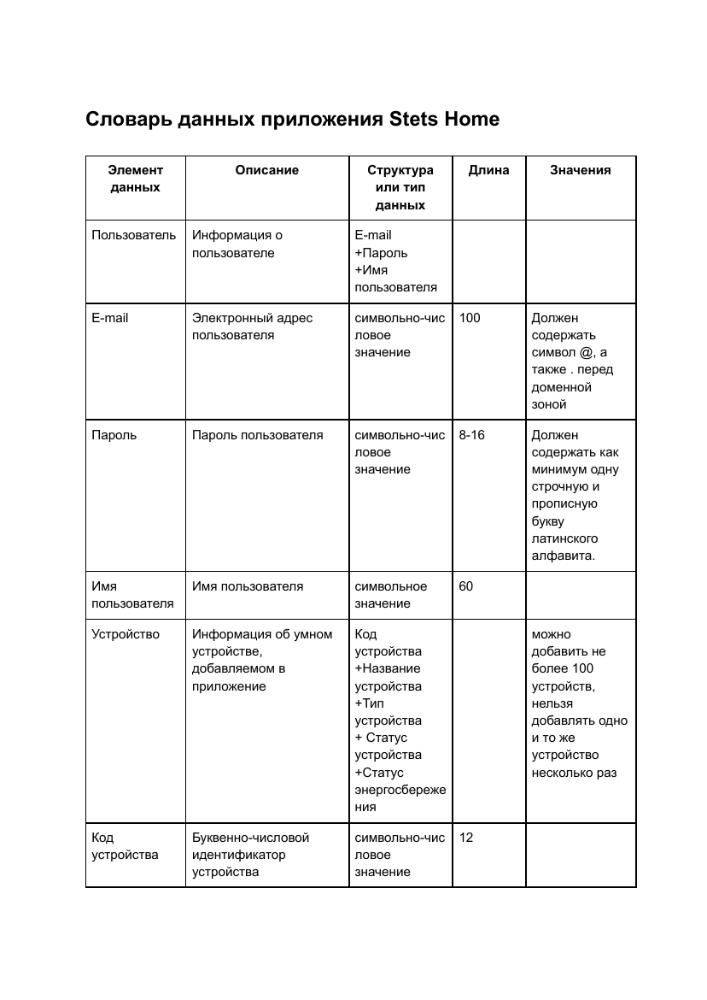

# 04 · Данные

ER-моделирование, нормализация и описание данных для двух систем.

[← К оглавлению](../README.md)

---

## Интернет-магазин «Накарабине»: от ER-модели к 3НФ

Последовательная проработка модели данных заказа: от общего описания сущности до нормализованной логической модели.

### Логическая ER-диаграмма в нотации Чена

Исходная модель: сущность «Заказ» со всеми атрибутами, включая составные — товар, доставка, оплата, пользователь.

### Та же модель в нотации Crow's Foot

Заказ одной таблицей — отправная точка для нормализации: данные товара, доставки, оплаты и покупателя повторяются в каждой строке.

### Нормализация: 1НФ → 2НФ → 3НФ

Пошаговое приведение модели к третьей нормальной форме. В итоге заказ разделён на сущности «Заказ», «Товары в заказе», «Товар», «Акция», «Доставка», «Пользователь» и «Оплата»; повторяющиеся данные вынесены, связи многие-ко-многим разрешены через «Товары в заказе».

Исходник: [nakarabine-data-modeling.drawio](nakarabine-data-modeling.drawio) — вкладки «Нотация Чена», «Нотация Crow's Foot», «Нормализованная модель» (и «Use Case» из [раздела требований](../01-requirements/README.md#use-case-интернет-магазина-накарабине)).

---

## Логическая модель данных Stets Home

Модель данных приложения «умный дом» в нотации Crow's Foot: пользователь, его дома, комнаты и их типы, устройства и модели устройств, сценарии автоматизации, шаблоны сценариев и расписание по дням недели. Связи многие-ко-многим разрешены через ассоциативные сущности «Дом пользователя», «Устройства в сценарии», «День недели в сценарии».

Исходник: [stets-home-data-model.drawio](stets-home-data-model.drawio).

## Словарь данных Stets Home

Для каждого элемента данных — описание, структура или тип, длина и допустимые значения. Например: e-mail до 100 символов с обязательными `@` и точкой перед доменной зоной, пароль 8–16 символов со строчной и прописной латинской буквой, не более 100 устройств у пользователя.

Файл: [data-dictionary-stets-home.pdf](data-dictionary-stets-home.pdf)
