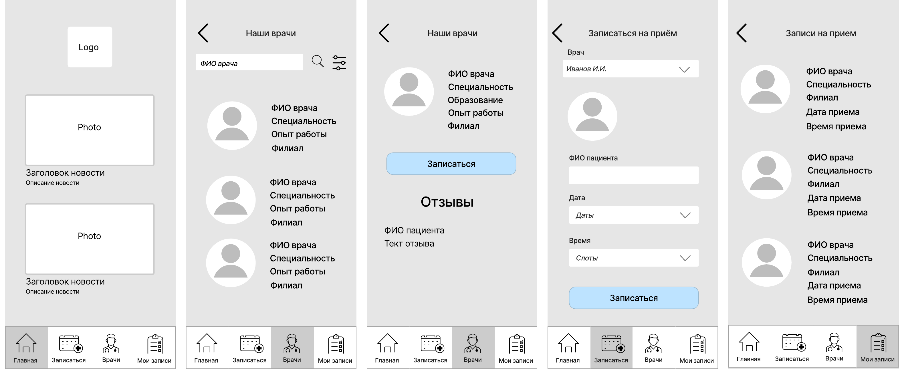
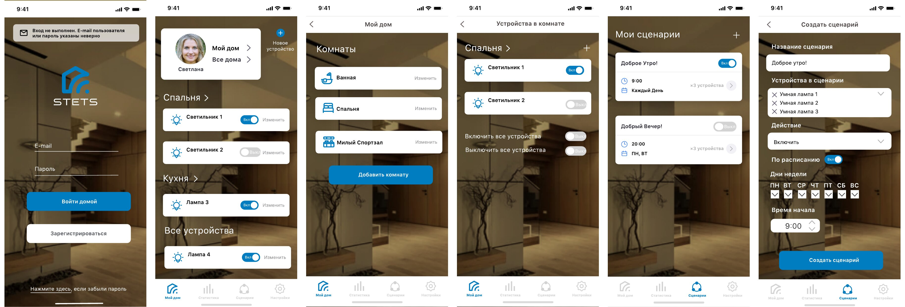
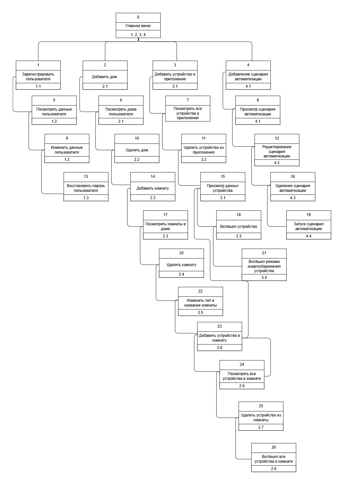

# 05 · Прототипы

Вайрфреймы и прототип мобильного приложения, а также структура интерфейса, связывающая экраны с функциями системы.

[← К оглавлению](../README.md)

---

## Вайрфреймы приложения записи к врачу

Low-fi вайрфреймы мобильного приложения клиники «Вита» - интерфейс для [процесса TO-BE](../02-processes/README.md#bpmn-to-be-запись-через-мобильное-приложение). 12 экранов:

- главная с новостями клиники;
- список врачей с поиском и фильтрами по специальности, опыту и филиалу, карточка врача с отзывами;
- запись на приём: врач, дата и свободный слот, подтверждение успешной записи;
- вход по номеру телефона и коду подтверждения, данные пользователя, список записей;
- экран ошибки.

Все экраны: [wireframes-clinic.pdf](wireframes-clinic.pdf) (в PDF есть закладки с названиями экранов).

---

## Прототип приложения Stets Home

Hi-fi прототип мобильного приложения «умный дом» - 27 экранов:

- вход, регистрация и восстановление пароля;
- дома и комнаты: добавление, редактирование, удаление с подтверждением;
- устройства: добавление по QR-коду или коду с упаковки, управление, режим энергосбережения;
- сценарии автоматизации: создание по расписанию и дням недели, просмотр, запуск, редактирование;
- профиль пользователя;
- состояния успеха, ошибки и подтверждения удаления.

Все экраны: [prototype-stets-home.pdf](prototype-stets-home.pdf) (в PDF есть закладки с названиями экранов).

## Структура интерфейса Stets Home

Иерархия экранов приложения от главного меню. У каждого экрана указан номер функции, которую он реализует: 1.x — пользователи, 2.x — дома и комнаты, 3.x — устройства, 4.x — сценарии. Эти же номера у процессов на [DFD](../03-system-design/README.md#dfd-приложения-stets-home), поэтому прототип, функции и потоки данных трассируются друг на друга.

Исходник: [stets-home-interface-structure.drawio](stets-home-interface-structure.drawio).
