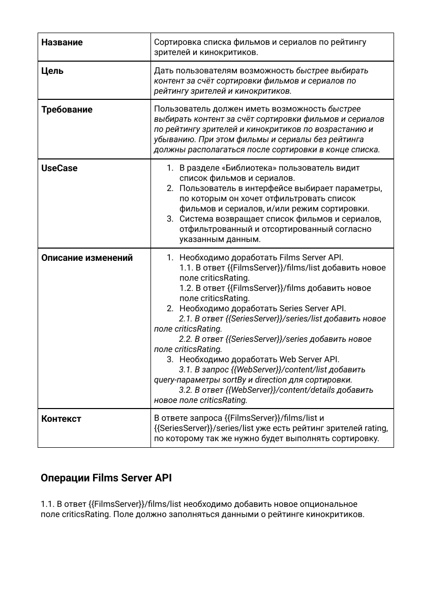
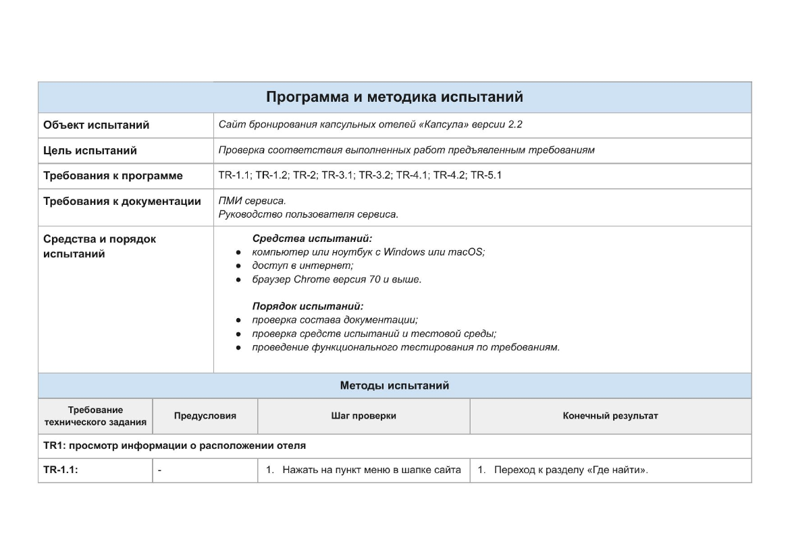
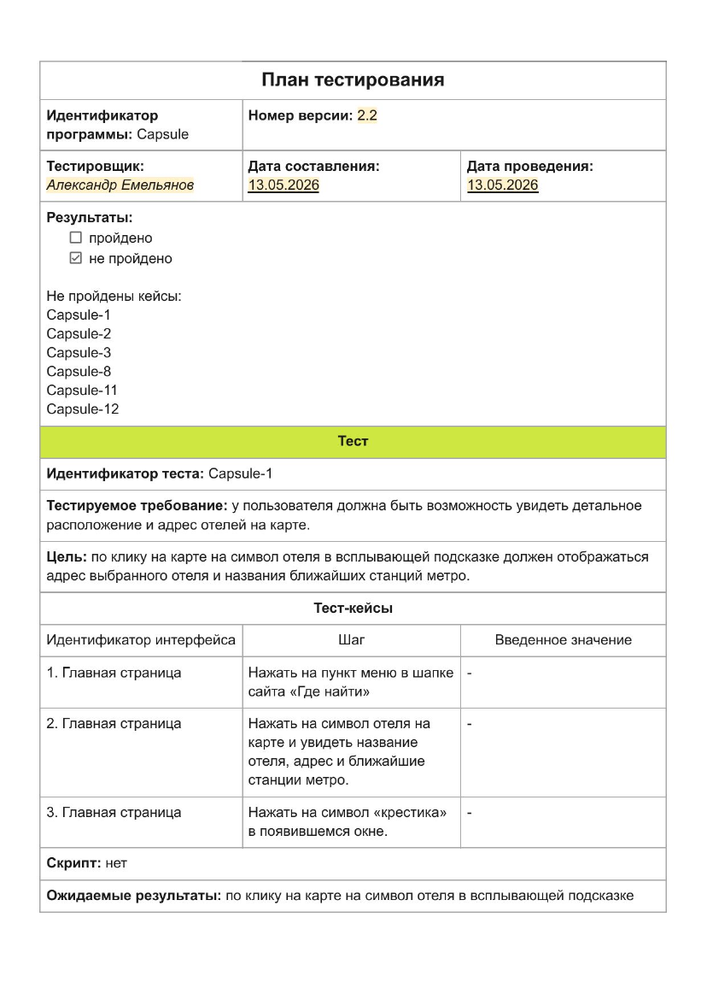
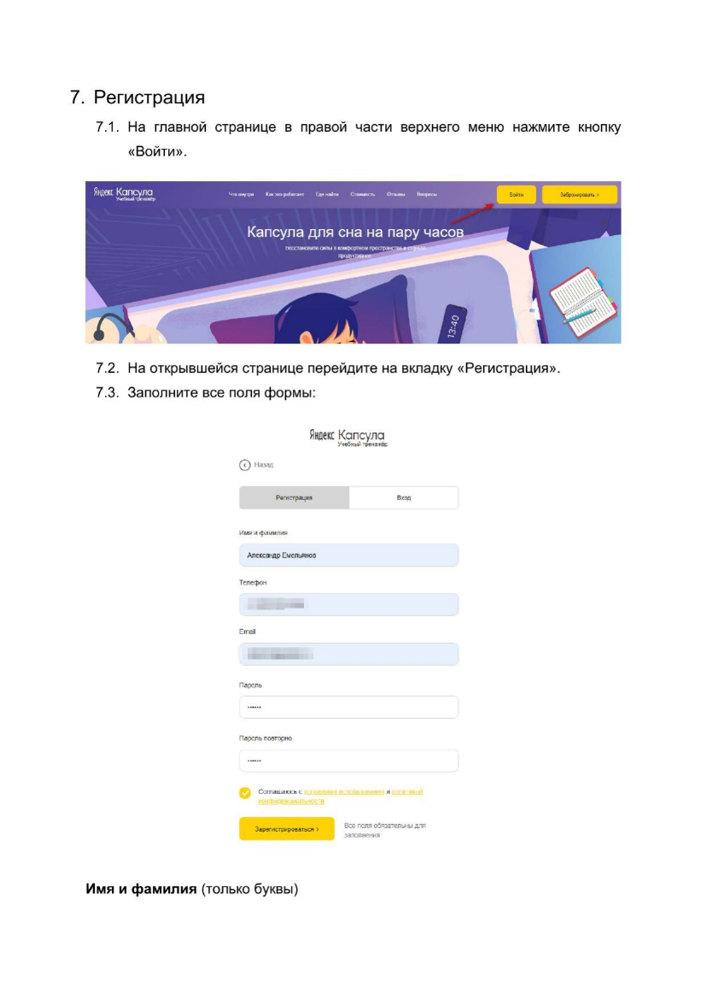

# 06 · Документация

Постановка задачи разработчикам и документация этапа испытаний и внедрения.

[← К оглавлению](../README.md)

---

## Задача на разработку: сортировка по рейтингу (Otium)

Тикет для команды онлайн-кинотеатра Otium: дать пользователям сортировать фильмы и сериалы по рейтингу зрителей и кинокритиков; контент без рейтинга — в конце списка.

Что внутри:
- цель, требование и пользовательский сценарий;
- изменения трёх API;
- по каждой операции - метод, URL, параметры, примеры запроса и ответа.

Схема взаимодействия сервисов - на [диаграмме последовательности](../03-system-design/README.md#sequence-список-фильмов-и-сериалов-otium).

Файл: [dev-task-otium-sorting.pdf](dev-task-otium-sorting.pdf)

---

## Сайт бронирования капсульных отелей «Капсула»

Три документа для испытаний и передачи в эксплуатацию версии 2.2 сайта.

### Программа и методика испытаний (ПМИ)

Объект и цель испытаний, проверяемые требования, средства и порядок испытаний. Для каждого требования - предусловия, шаги проверки и ожидаемый результат.

Файл: [test-program-kapsula.pdf](test-program-kapsula.pdf)

### План тестирования

Протокол прогона 12 тестов: проверяемое требование, цель, шаги, ожидаемый и фактический результат.

Файл: [test-plan-kapsula.pdf](test-plan-kapsula.pdf)

### Руководство пользователя

18 страниц со скриншотами: назначение и условия работы, просмотр информации об отелях и ценах, регистрация и вход, бронирование с регистрацией и без, управление бронированиями. Отдельный раздел «Сообщения оператору» — типовые ошибки: почему возникают и что делать.

Файл: [user-guide-kapsula.pdf](user-guide-kapsula.pdf)
